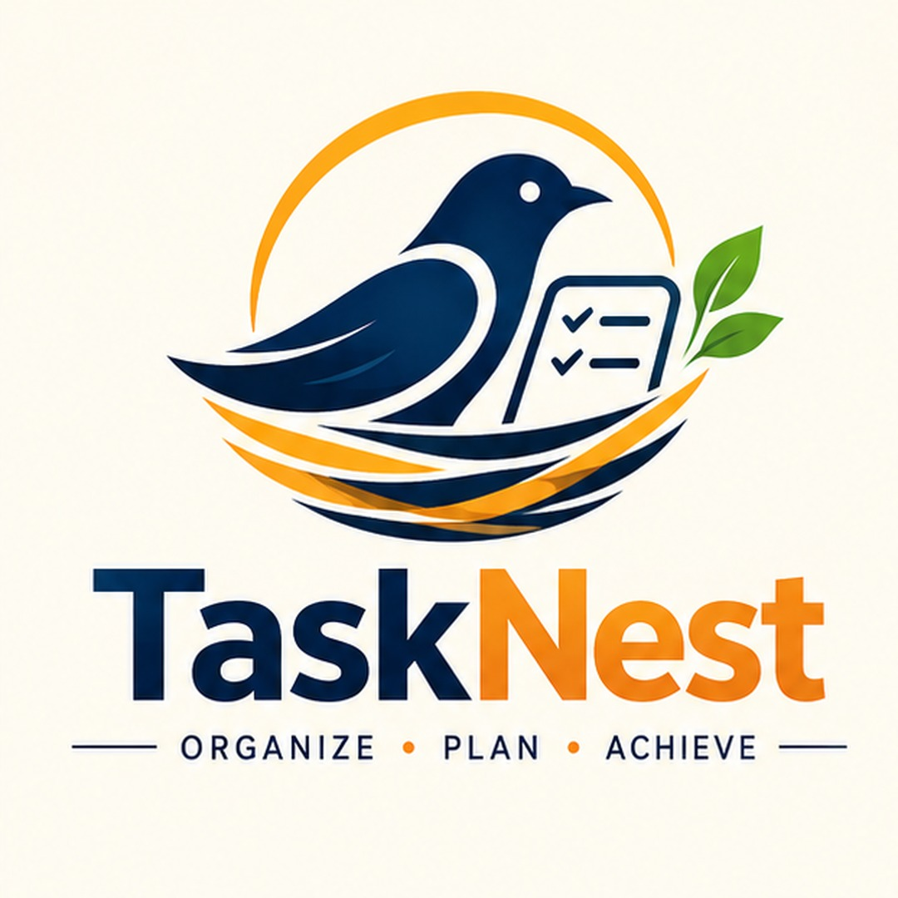
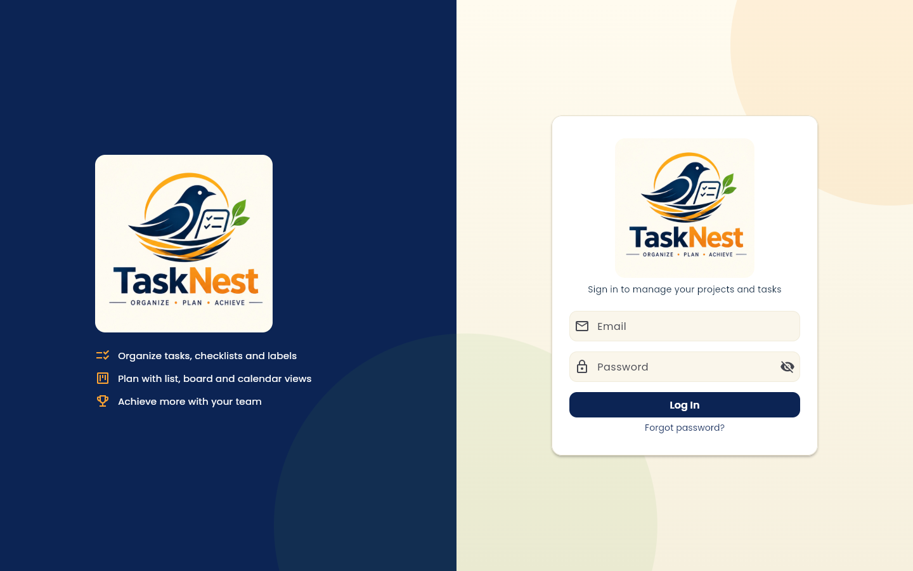
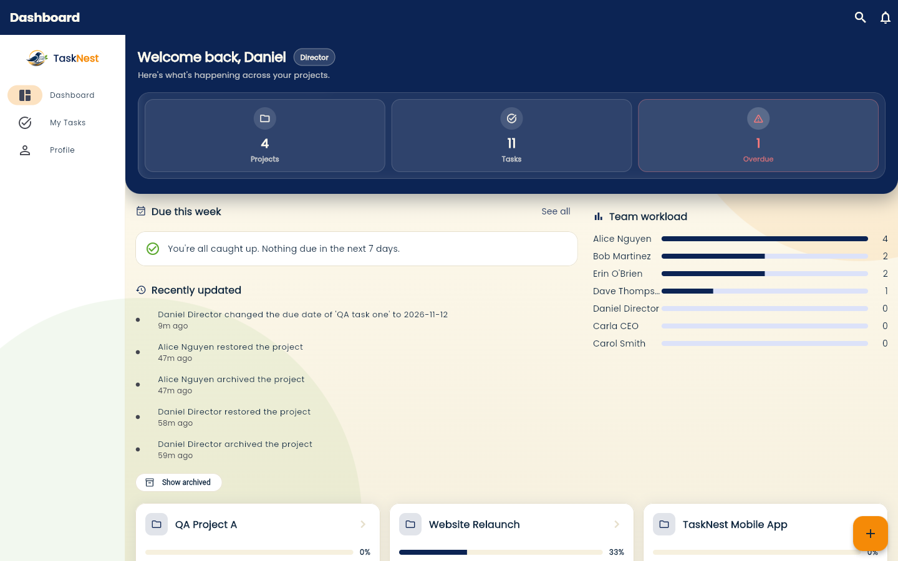
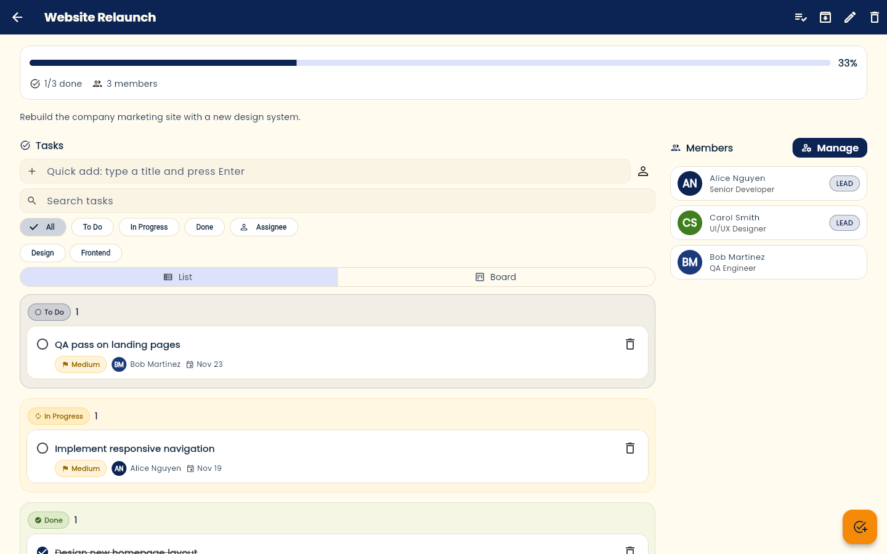
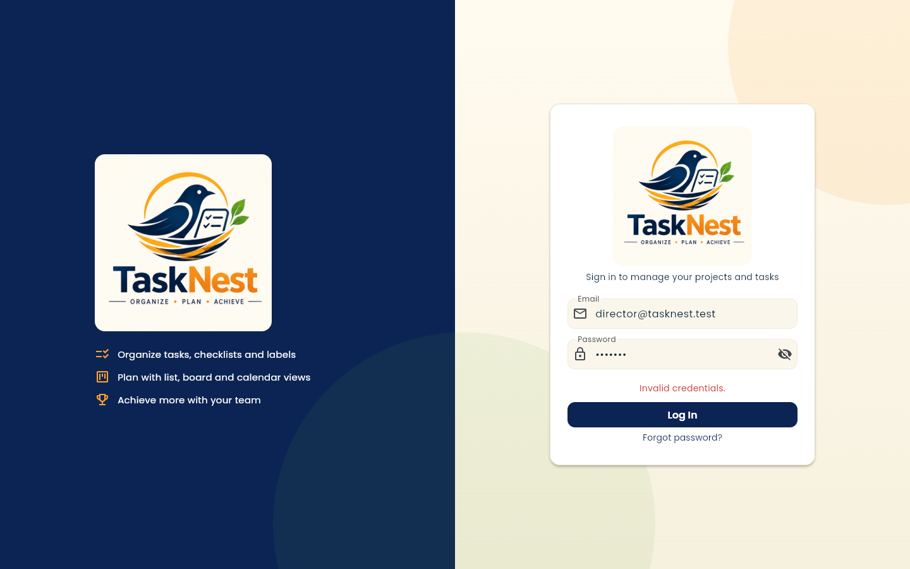
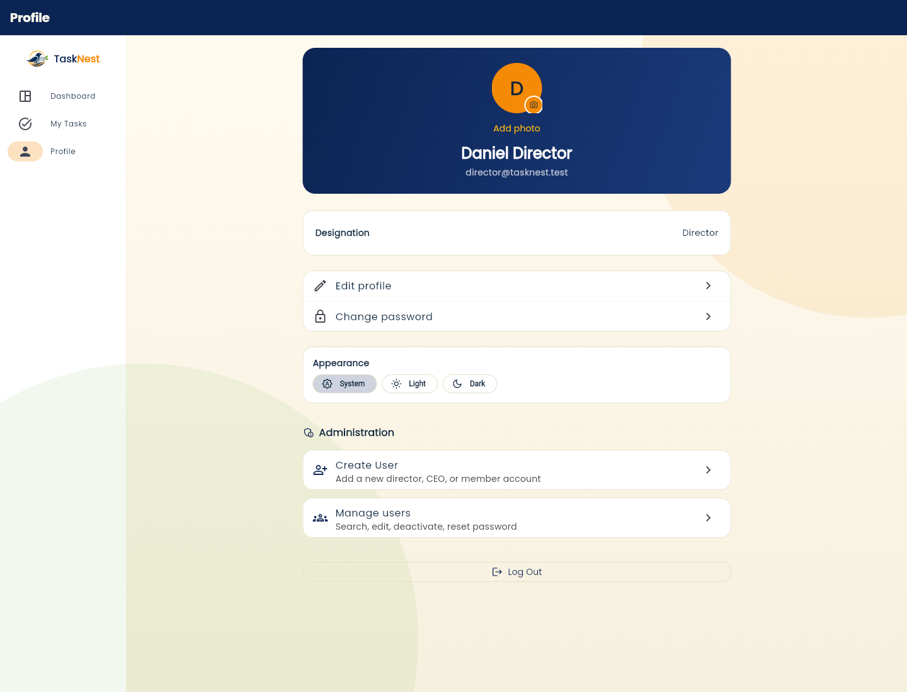
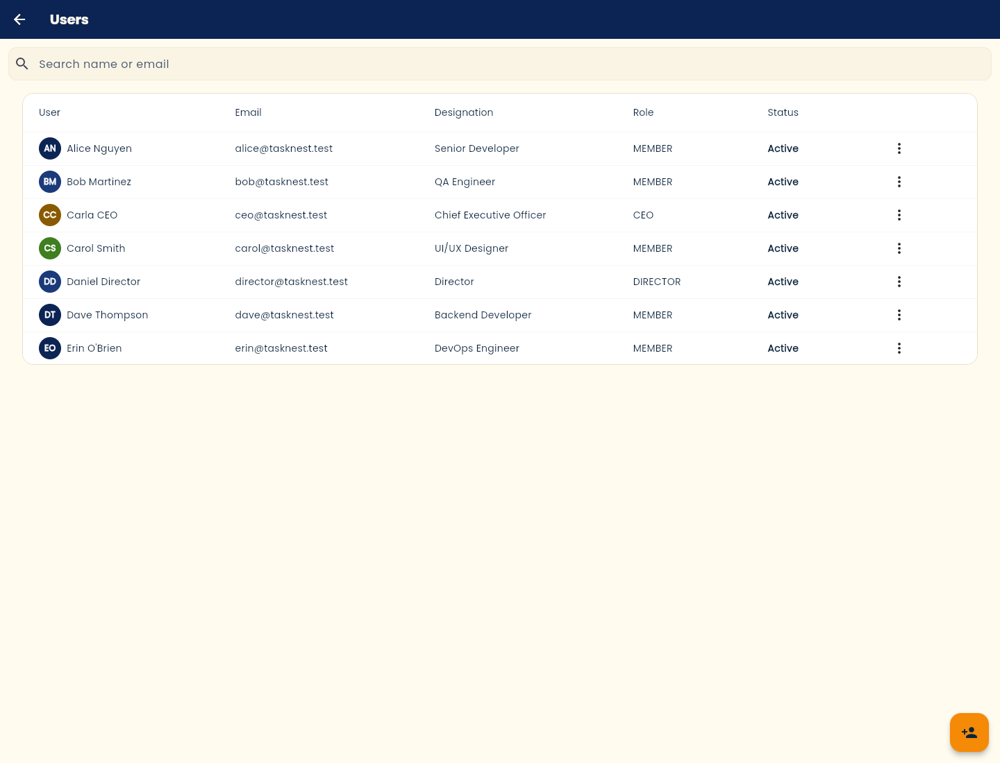
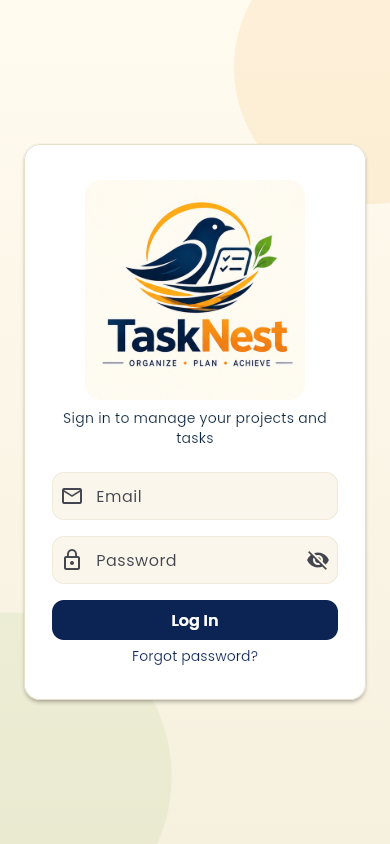
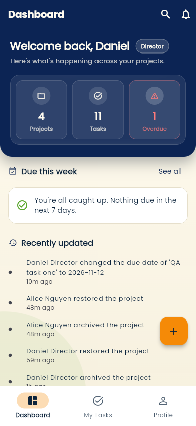
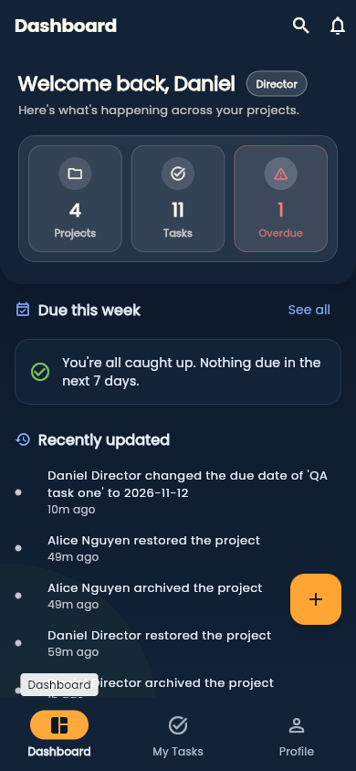

<p align="center"></p>

# TaskNest App

Flutter client (web, Android, iOS, desktop) for **TaskNest**, a project and task management app.

> **Backend:** this app needs the [TaskNest API](https://github.com/sytal/tasknest-backend) (Laravel). Run the backend first, then point the app at it (see [Run it](#run-it)).


## Features
- Responsive UI for phones, tablets and desktop: bottom navigation, icon rail and a full navigation rail with brand header.
- Light, dark and system theme (saved per device), brand palette navy / orange / amber / leaf.
- Dashboard with project progress, due soon, recent activity and team workload.
- Projects (members, lead/member roles, archive), tasks (list and drag-and-drop board, subtasks, labels, comments, activity).
- Calendar of due dates, global search, notifications bell, avatar upload with friendly errors.
- Director/CEO administration: create, edit, deactivate users and reset passwords. The account role is visible only to management; everyone sees a designation, editable only by the CEO.
- Login rate-limit countdown, forgot/reset password, session restore, unsaved-changes guard.

## Screenshots
| Login | Dashboard |
|---|---|
|  |  |

| Project | Calendar |
|---|---|
|  |  |

| Profile | Users (admin) |
|---|---|
|  |  |

**Mobile and dark theme**

<p>




</p>

## Run it
1. Start the API ([backend README](https://github.com/sytal/tasknest-backend#quick-start)):
   ```bash
   git clone https://github.com/sytal/tasknest-backend && cd tasknest-backend
   composer install && cp .env.example .env && php artisan key:generate
   touch database/database.sqlite && php artisan migrate --seed
   php artisan serve --port=8012
   ```
2. Run the app:
   ```bash
   git clone https://github.com/sytal/tasknest-app && cd tasknest-app
   flutter pub get
   flutter run -d chrome                      # API defaults to http://127.0.0.1:8012/api
   # other API URL (device, staging, production):
   flutter run --dart-define=API_BASE_URL=http://192.168.1.10:8012/api
   ```
   For a browser build the backend must allow your origin in `CORS_ALLOWED_ORIGINS`.
3. Log in with a demo account (password `password`): `director@tasknest.test`, `ceo@tasknest.test`, `alice@tasknest.test`, `bob@tasknest.test`.

## Build
```bash
flutter build web --dart-define=API_BASE_URL=https://api.example.com/api
flutter build apk  --dart-define=API_BASE_URL=https://api.example.com/api
```
Android release builds are currently signed with the debug key: add your own keystore in `android/app/build.gradle.kts` before publishing to a store.

## Quality
```bash
flutter analyze
flutter test      # unit, widget and responsive overflow tests (login 280-1440 px, text scale 2x)
```
`integration_test/` needs a browser driver and is not part of CI.

## Project layout
`lib/core` (theme, layout, shared widgets) · `lib/screens` · `lib/widgets` · `lib/services` (API client, session, theme) · `lib/models`.
